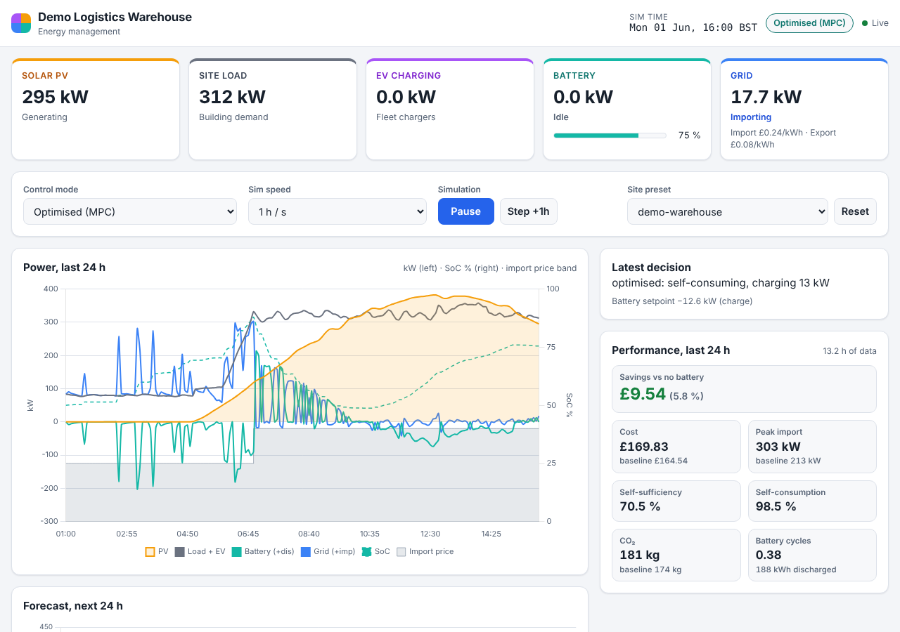

# Site EMS

A site energy management system (EMS) for commercial and industrial sites with rooftop PV,
a battery energy storage system (BESS), EV fleet charging and a grid connection. It decides
the battery setpoint every control interval to cut energy cost, shave import peaks and use
more of the site's own solar. It ships with a built-in site simulator, so the whole control
loop, the REST/WebSocket API and the operator dashboard run on a laptop without any hardware.



## Features

- **Five control modes**: idle baseline, self-consumption, peak shaving, time-of-use
  arbitrage and a forecast-driven optimiser (dynamic programming over a 24 h horizon).
- **Site simulator**: clear-sky PV with seeded weather, building load profiles (warehouse,
  office, retail), EV sessions per charger, battery efficiency and SoC limits, and grid
  import/export limits (EV shed first, PV curtailed first). Deterministic for a given seed.
- **Noisy 24 h forecasts** whose error grows with lead time, used by the optimiser, peak
  shaving and TOU arbitrage.
- **KPIs against a no-battery baseline**: cost including prorated demand and standing
  charges, savings, peak import, self-consumption, self-sufficiency, CO2, battery cycles.
- **REST + WebSocket API** (FastAPI) to read status, history, KPIs and forecasts, switch modes
  and drive the simulation.
- **Operator dashboard** (vanilla JS + Chart.js, no build step): live power-flow tiles,
  controls, a 24 h power chart with SoC and price band, KPI panel, latest decision reason
  and a forecast chart. Works at phone width and in light or dark mode.
- **CLI** to compare every control mode on a site over N simulated days.

## Quickstart

Requires Python 3.11+.

```bash
pip install -e '.[dev]'          # add ,live for WebSocket push: pip install -e '.[dev,live]'

python -m ems serve              # API + dashboard on http://localhost:8000/
python -m ems serve --site demo-office --speed 3600 --port 8765

python -m ems simulate --site demo-warehouse --days 7     # compare all modes
python -m ems simulate --site demo-office --days 7 --mode optimised

python -m pytest -q              # test suite
```

Open the printed address in a browser. `--speed` is simulated seconds per real second
(3600 runs one simulated hour per second). Without a WebSocket backend (`websockets` or
`wsproto`, installed by the `live` extra) the server says so at startup and the dashboard
polls the API instead of streaming; everything else works the same.

Two demo sites are built in (`ems/presets.py`), both on the same generic UK commercial
time-of-use tariff (night £0.15, day/evening £0.24, 16:00 to 19:00 peak £0.38 per kWh,
export £0.08 per kWh, £4.50 per kW-month demand charge):

| Preset | PV | Battery | EV | Grid limits (import/export) | Peak target |
|---|---|---|---|---|---|
| `demo-warehouse` | 500 kWp | 500 kWh / 250 kW | 8 × 22 kW | 500 / 200 kW | 300 kW |
| `demo-office` | 150 kWp | 200 kWh / 100 kW | 4 × 7.4 kW | 200 / 50 kW | 110 kW |

## Control modes

Sign conventions throughout: battery power is positive when discharging, grid power is
positive when importing, and `grid = load + ev - pv - battery`.

| Mode | What it does |
|---|---|
| `idle` | Battery held at 0 kW. This is the no-battery baseline every other mode is compared to. |
| `self_consumption` | Charges from PV surplus and discharges to cover the site deficit, driving grid flow toward zero. |
| `peak_shaving` | Discharges to keep import at or below the site's peak target (80% of the import limit if none is set), acting on the higher of the last meter reading and the forecast for the coming interval so it anticipates shift starts. Recharges below the target from PV surplus first, then in the cheapest band (keeping a 3% margin under the target for load noise), and tops up slowly when the reserve falls under half the usable window. In the dearest band, energy above that reserve covers site demand. |
| `tou_arbitrage` | Charges at full power in the cheapest band without breaking the peak target (with the same 3% margin), covers site demand in the dearest band and self-consumes otherwise. It never exports stored energy, because export is worth less than any import price. |
| `optimised` | Model-predictive control: every interval it solves a dynamic programme over the 24 h forecast (81 SoC levels). The objective is import cost minus export revenue, plus penalties above the peak target and import limit, plus a small cost for battery wear. It applies the first step and follows measured load when the plan is to self-consume or shave. Planned grid charging is capped so the expected import (the higher of measured and forecast demand) stays at or below the peak target. |

All modes respect the SoC window, inverter ratings and grid limits. Every command carries a
plain-language reason, which the dashboard shows.

## Simulated results

Output of `python -m ems simulate --site demo-warehouse --days 7`. Each mode runs on a fresh
engine from 2026-06-01, with the same seed and a 300 s control step:

```text
Site: Demo Logistics Warehouse (demo-warehouse) | 7 day(s) | step 300 s
Metric                        idle  self_consumption  peak_shaving  tou_arbitrage  optimised
------------------------  --------  ----------------  ------------  -------------  ---------
Cost (GBP)                4,917.46          4,772.12      4,664.21       4,604.32   4,336.62
Baseline cost (GBP)       4,917.46          4,917.46      4,917.46       4,917.46   4,917.46
Savings (GBP)                 0.00            116.88        283.83         312.78     555.16
Import (kWh)              19,221.2          18,554.5      19,684.9       19,196.6   18,955.6
Export (kWh)                 665.5             122.0         740.6          269.4      231.7
PV generation (kWh)       16,784.3          16,784.3      16,784.3       16,784.3   16,784.3
PV curtailed (kWh)             0.0               0.0           0.0            0.0        0.0
Site demand (kWh)         35,340.0          35,340.0      35,340.0       35,340.0   35,340.0
Self-consumption (%)          96.0              99.3          95.6           98.4       98.6
Self-sufficiency (%)          45.6              47.5          44.3           45.7       46.4
Peak import (kW)             358.3             358.3         310.5          358.3      314.4
Baseline peak (kW)           358.3             358.3         358.3          358.3      358.3
CO2 (kg)                   3,978.8           3,840.8       4,074.8        3,973.7    3,923.8
Baseline CO2 (kg)          3,978.8           3,978.8       3,978.8        3,978.8    3,978.8
Battery throughput (kWh)       0.0             788.7       1,459.4        3,367.7    3,226.0
Equivalent cycles             0.00              1.58          2.92           6.74       6.45

Battery SoC start -> end (stored-energy change, valued in Savings):
  idle              0.50 -> 0.50  (+0.0 kWh, +0.00 GBP)
  self_consumption  0.50 -> 0.10  (-200.0 kWh, -28.46 GBP)
  peak_shaving      0.50 -> 0.93  (+214.9 kWh, +30.58 GBP)
  tou_arbitrage     0.50 -> 0.49  (-2.5 kWh, -0.36 GBP)
  optimised         0.50 -> 0.14  (-180.4 kWh, -25.68 GBP)
```

Over this week the optimiser saves about 11% against the no-battery baseline and cuts the
import peak by 44 kW. Peak shaving cuts the peak by 48 kW for about half the saving. Modes that
charge from the grid use more energy overall because of round-trip losses, so their import
and CO2 can be higher than the baseline even when they cost less. All modes start at 50% SoC.
Savings include the change in energy stored in the battery, valued at the cheapest import
price times the discharge efficiency: a mode that ends with a fuller battery is not charged
for energy it still holds, and one that drains the battery is not credited with energy bought
before the run. "Cost" is the plain bill. The block under the table shows each mode's start and
end SoC and the stored-energy value included in its savings.

## API

The full contract, with data models and every endpoint, is in
[ARCHITECTURE.md](ARCHITECTURE.md). In summary:

| Method | Path | Purpose |
|---|---|---|
| GET | `/api/health` | Liveness, and whether `/ws/telemetry` is available |
| GET | `/api/status` | Mode, sim clock, latest telemetry, last command |
| GET | `/api/config`, `/api/presets` | Active site config, preset names |
| GET | `/api/history?limit=288` | Recent telemetry |
| GET | `/api/kpis?hours=24` | KPIs vs baseline over whole control intervals overlapping the window (409 before any data) |
| GET | `/api/forecast?hours=24` | PV, demand and price forecast |
| POST | `/api/mode` | `{"mode": "peak_shaving"}` |
| POST | `/api/sim` | `{"speed": 600, "running": true}` |
| POST | `/api/step` | `{"steps": 12}`, run steps immediately |
| POST | `/api/reset` | `{"preset": "demo-office"}`, restart (optionally on another site) |
| WS | `/ws/telemetry` | Pushes `{"type": "telemetry", "data": ...}` every step |

Interactive OpenAPI docs are served at `/docs`.

## Project layout

```text
ems/
  models.py        shared pydantic models and sign conventions
  presets.py       demo site configurations
  simulator/       site physics: PV, load, EV fleet, battery, grid limits, forecasts
  control/         controllers (rules.py), DP optimiser (optimiser.py), shared limits (base.py)
  reporting/       KPI calculation and the CLI comparison table
  core/engine.py   control loop: observe, forecast, decide, simulate, record, publish
  api/app.py       FastAPI app: REST, WebSocket, dashboard static files
  dashboard/static index.html, app.js, styles.css
  __main__.py      CLI: serve, simulate
tests/             pytest suites, one per module
docs/screenshots/  dashboard screenshots
ARCHITECTURE.md    module contracts and API specification
```

## Limitations

- **Simulated only.** The EMS controls the built-in simulator. There are no hardware
  adapters for inverters, meters or chargers.
- **Synthetic forecasts.** PV and demand forecasts are the simulator's truth plus correlated
  noise, not weather or machine-learning forecasts.
- **In-memory history.** Telemetry is kept in a bounded in-memory buffer (30 days at 5 min)
  and is lost on restart. There is no persistent store and no authentication.
- **EV charging is not dispatched.** Controllers leave EV power unconstrained. The simulator
  sheds EV load only to respect the import limit.
- **Single site, single tariff** per engine. The demand charge is prorated over the run
  rather than billed on a calendar month.
- The dashboard loads Chart.js from cdnjs. Without it, tiles and KPIs still work but charts
  are hidden.

## Roadmap

- Hardware adapters: Modbus TCP / SunSpec for PV inverters, battery and meters.
- OCPP 1.6/2.0.1 central system for smart EV charging, with EV power as an optimiser decision.
- Persistent time-series store (for example SQLite or TimescaleDB) and longer KPI reporting.
- Real forecasts: weather-API irradiance and learned load models.
- Monthly billing, multiple tariffs and export schemes, and a multi-site view.
- Authentication and role-based control for the API and dashboard.

## License

See [LICENSE](LICENSE).
